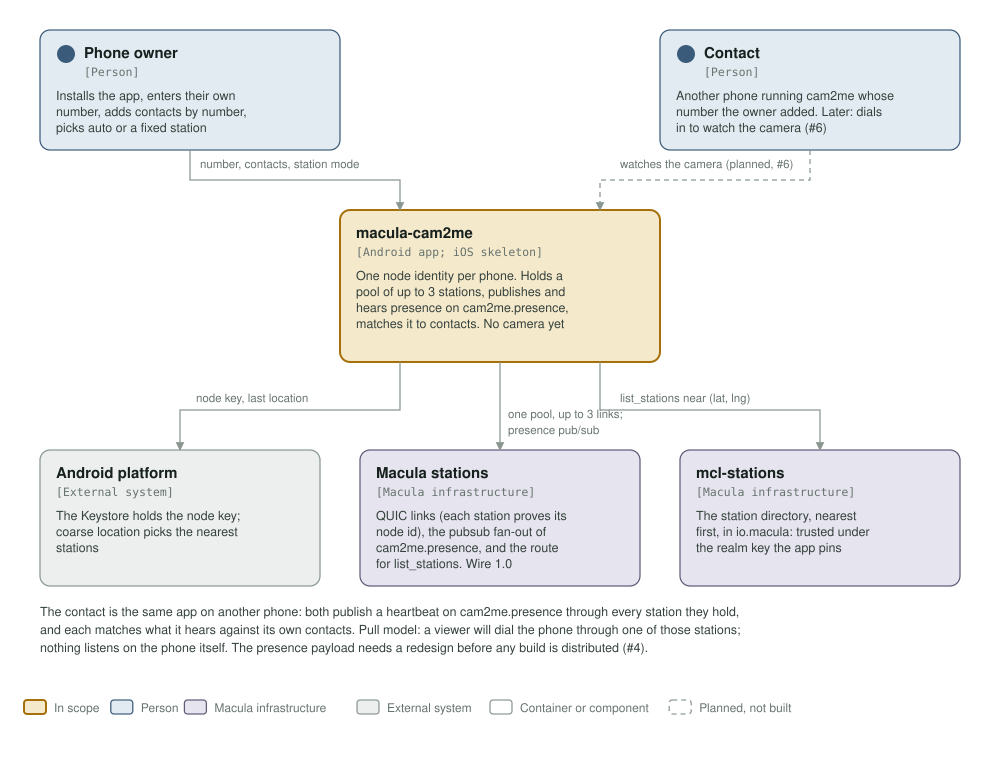
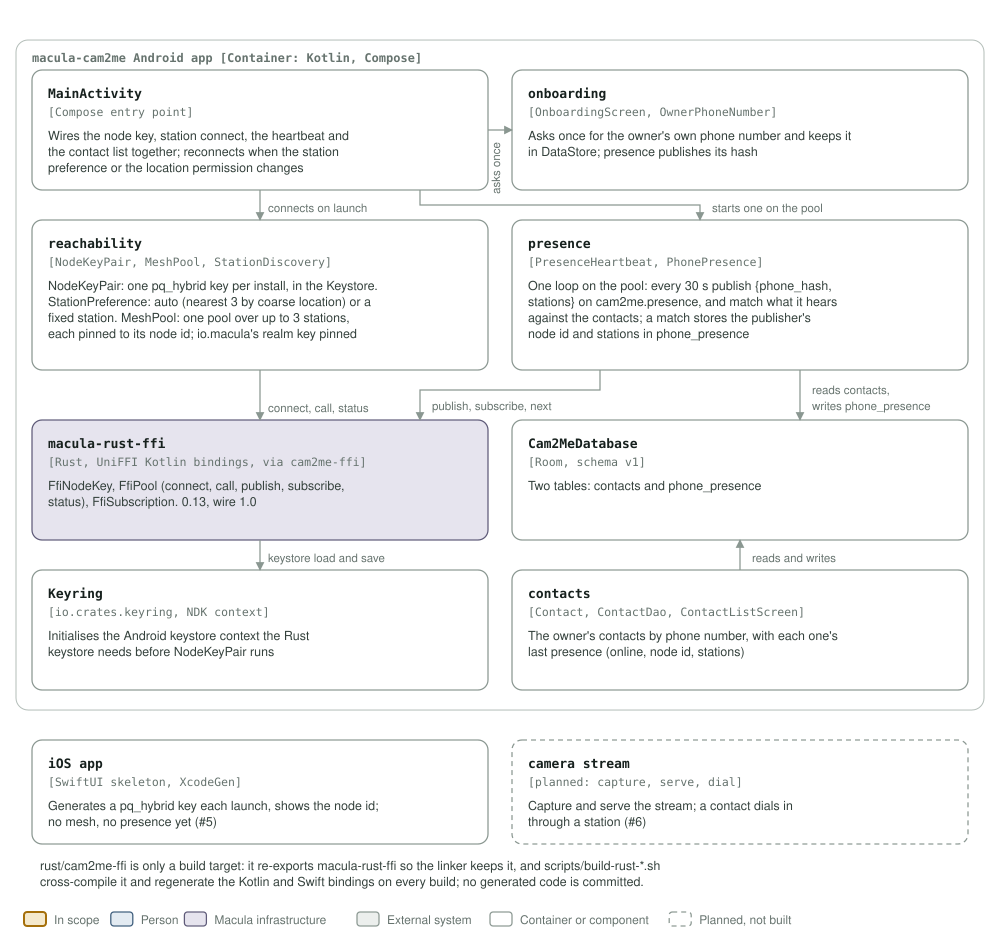

# macula-cam2me architecture: C4 model

*This exists so a reader can see what macula-cam2me talks to, and what it is
made of, without reading it.*

**Status: early, and not on the live fleet.** The Android app holds a node
identity, contacts and a presence heartbeat; the iOS app is a skeleton; the
camera, the thing the app is for, is not built. The Rust core it links predates
wire 1.0, so today it reaches no station of the live fleet
([#3](https://github.com/macula-apps/macula-cam2me/issues/3)). The diagrams show
the app as it is on `main`, with those gaps marked, not the app as planned.

## Level 1: system context

| Element | Kind | Role |
| --- | --- | --- |
| macula-cam2me | In scope | One node identity per phone. Holds up to three station sessions at once, publishes a presence heartbeat on `cam2me.presence` through each, hears everyone else's, and matches what it hears against the owner's contacts |
| Phone owner | Person | Installs the app, enters their own phone number once, adds contacts by phone number, and picks automatic (nearest stations) or one fixed station |
| Contact | Person | Another phone running cam2me whose number the owner added. Later, the person who dials in to watch the camera ([#6](https://github.com/macula-apps/macula-cam2me/issues/6)) |
| Android platform | External system | The Android Keystore holds the node seed, and coarse location picks the nearest stations. Contacts and presence live in the app's own Room database (Level 2) |
| Macula stations | Macula infrastructure | The QUIC sessions, the pubsub fan-out of `cam2me.presence`, and the route the `list_stations` call takes. The live fleet runs wire 1.0, which the pinned SDK cannot speak (#3) |
| mcl-stations | Macula infrastructure | The station directory, nearest first. The app still calls it by its retired name, `hecate_stations.list_stations`, in a realm that is not io.macula (#3), so discovery falls back to the fixed station |

The contact is the same app on another phone: both publish on
`cam2me.presence` through every station they hold, and each matches what it
hears against its own contacts. The model is pull: a viewer will dial the phone
through one of those stations, and nothing listens on the phone itself. The
presence payload itself needs a redesign before the app goes live
([#4](https://github.com/macula-apps/macula-cam2me/issues/4)).

Out of scope here: the stations, the directory and the SDK. They are Macula
infrastructure, documented in their own repositories; this model only shows
which of their surfaces the app uses.

## Level 2: components

| Component | Technology | Responsibility |
| --- | --- | --- |
| `MainActivity` | Kotlin, Jetpack Compose | The entry point. Wires the node key, station connect, the heartbeats and the contact list together, and reconnects when the station preference or the location permission changes. Connects in two phases: the fixed station first, as the route for discovery, then the chosen set |
| `onboarding` | `OnboardingScreen`, `OwnerPhoneNumber` | Asks once for the owner's own phone number and keeps it in DataStore; presence publishes its hash |
| `reachability` | `NodeKeyPair`, `StationPreference`, `LocationFix`, `StationDiscovery`, `MeshSessionPool`, `KnownStations` | One Ed25519 key per install, in the Android Keystore (migrated once from the older plain DataStore). Automatic mode asks the directory for the nearest three stations from the last coarse location; the fixed mode uses one station. `MeshSessionPool` keeps up to three sessions, opens only new ones, closes unwanted ones, and pins trust to a station's node id when discovery supplied one (WebPKI on the hostname otherwise) |
| `presence` | `PresenceHeartbeat`, `PhonePresence` | One sequential loop per session: every 30 s it publishes `{phone_hash, stations}` on `cam2me.presence`, and polls for what others publish. A heartbeat whose hash matches a contact's number stores the publisher's node id and stations in `phone_presence` |
| `contacts` | `Contact`, `ContactDao`, `ContactListScreen` | The owner's contacts by phone number, shown online when a heartbeat matched them recently |
| `Cam2MeDatabase` | Room, schema v1 | Two tables: `contacts` and `phone_presence` |
| `Keyring` | `io.crates.keyring` | Initialises the Android keystore context the Rust keystore needs before `NodeKeyPair` runs |
| `macula-rust-ffi` | Rust, UniFFI Kotlin bindings | `FfiKeyPair` and `FfiSession` (connect, call, publish, subscribe, `recvEvent`). Pinned at 0.3.1, before wire 1.0 (#3) |
| iOS app | SwiftUI, XcodeGen | A skeleton: generates a key on every launch and shows the node id. No persistence, no mesh, no presence ([#5](https://github.com/macula-apps/macula-cam2me/issues/5)) |
| camera stream | planned | Capture and serve the stream; a contact dials in through a station (#6) |

`rust/cam2me-ffi` is only a build target. It re-exports `macula-rust-ffi` so the
linker keeps it, and `scripts/build-rust-android.sh` and
`scripts/build-rust-ios.sh` cross-compile it and regenerate the Kotlin and Swift
bindings on every build, so no generated code is committed. The realm the app
uses is one constant, `AppRealm.kt`, shared by `reachability` and `presence`.

## Drawing them

`assets/c4-context.svg` and `assets/c4-components.svg` are generated by
`architecture/c4_diagrams.py` (`python3 architecture/c4_diagrams.py`). They are
drawn from the code, never from this page: the Kotlin packages under
`android/app/src/main/kotlin/io/macula/cam2me/`, the Swift sources under
`ios/MaculaCam2Me/`, and the dependency in `rust/cam2me-ffi/Cargo.toml`. When
one of those changes shape, the diagram changes in the same commit.

The SVGs are self-contained, so they render the same everywhere they are read
(GitHub, an IDE, `rsvg-convert`). Colours are literal values in plain classes,
plus a `prefers-color-scheme` dark block. They are never CSS custom properties,
which `rsvg-convert` renders black. The generator refuses to write a box that is
too small for its own text or a line wider than its box, so a stale box fails
the run rather than overlapping the next one.

The `c4-model` job in `.github/workflows/c4-model.yml` keeps them here: it is red
until both files exist and are shown, and red again if either goes missing.
